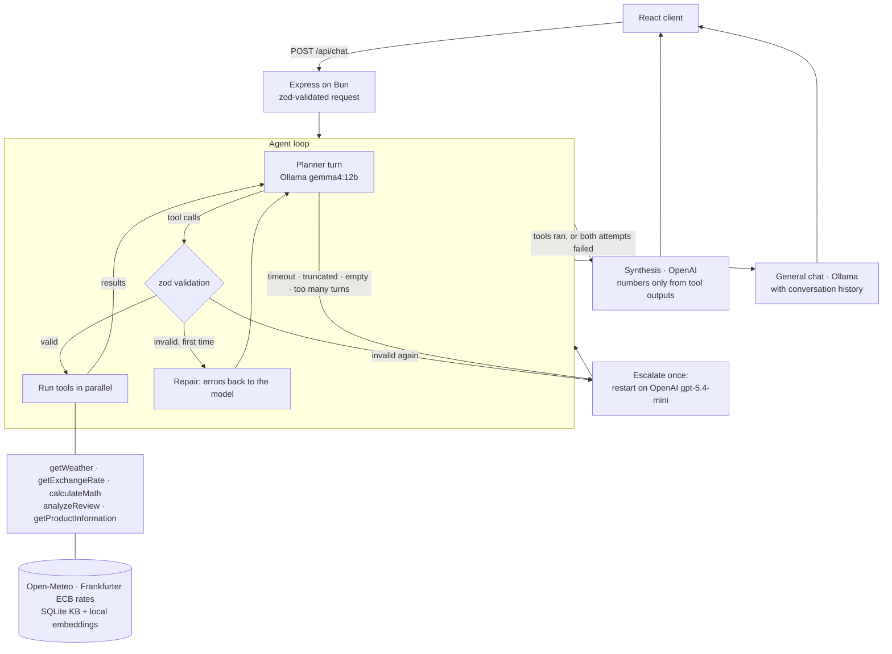

# Hybrid Product Information Agent

A tool-calling assistant that plans on a local model and escalates to OpenAI only when it fails in a way it can detect. Every change is measured against a 30-case eval harness.

**TL;DR**

- **What it is:** a chat assistant for a small product store. It answers product questions from a RAG knowledge base and handles live weather, live exchange rates to ILS, review analysis and exact arithmetic through native tool calls. It runs on Bun, Ollama and SQLite, and uses OpenAI only for the components that need it.
- **What's interesting:** the tool planner runs locally (`gemma4:12b`). Tool calls are validated with zod, and an invalid turn gets one repair, then at most one escalation to OpenAI. Synthesis may only state numbers that a tool produced, and an eval scorer checks that it does.
- **Headline result:** **87/90** on the golden set with tool planning on local `gemma4:12b`, and **90/90** with every component on `gpt-5.4-mini`. Escalation rate: 0%.

---

## Demo

<!-- TODO: demo GIF / screenshot -->

Example requests, with the tool calls and answers from the latest default-config eval run (`gemma4:12b` planning). Tools in the same turn run in parallel.

**Weather + exchange rate**

```
> What is the weather in Paris and what is the USD exchange rate today?
turn 1  getWeather({ city: "Paris" })
        getExchangeRate({ currencyCode: "USD", amount: null })
→ "Paris, France: 15.1°C, partly cloudy, wind 2.6 km/h.
   USD exchange rate today: 1 USD = 3.1259 ILS (ECB reference rate of 2026-10-28)."
```

**Budget question (multi-turn: each step needs the previous result)**

```
> I have 3000 ILS. If I buy the Skyline Drone M2, how many ILS will I have left?
turn 1  getProductInformation({ product_name: "Skyline Drone M2", query: "price in USD" })   → 689 USD
        getExchangeRate({ currencyCode: "USD", amount: null })                              → 3.1259
turn 2  calculateMath({ expression: "689 * 3.1259" })                                       → 2153.7451
turn 3  calculateMath({ expression: "3000 - 2153.7451" })                                   → 846.25
→ "You will have 846.25 ILS left."
```

**Review analysis + knowledge base**

```
> Analyze this review on EvoPhone X: 'The phone is great but battery is weak',
  then tell me the average battery life from the KB.
turn 1  analyzeReview({ reviewText: "The phone is great but battery is weak" })
        getProductInformation({ product_name: "EvoPhone X", query: "battery life" })
→ "The review is mixed: the phone is described as great, but the battery is weak. The KB says
   EvoPhone X has an average battery life of about 9 hours of active screen-on time under mixed usage."
```

**Product that isn't in the knowledge base**

```
> What is the price of the EvoPhone Z?
turn 1  getProductInformation({ product_name: "EvoPhone Z", query: "price in USD" })
→ "I couldn't find the price of the EvoPhone Z in the retrieved information."
```

The KB has an EvoPhone X. The eval fails the run if the answer borrows its price.

Requests that need no tool ("Explain what a data lakehouse is") go straight to the chat model, which also gets the conversation history.

---

## Quick start

**Requirements**

- [Bun](https://bun.sh) ≥ 1.3
- [Ollama](https://ollama.com), running locally
- ~24 GB RAM (unified memory on Apple Silicon works well). `gemma4:12b` and `embeddinggemma` take roughly 9 GB.
- An OpenAI API key
- `jq`, only for the smoke script

**Setup**

```bash
bun install

ollama serve                   # keep it running in its own terminal
ollama pull gemma4:12b         # tool planner + general chat
ollama pull embeddinggemma     # embeddings (always local)

cp packages/server/.env.example packages/server/.env   # then set OPENAI_API_KEY

cd packages/server
bunx prisma migrate dev        # creates prisma/chatbot.db and generates the client
bunx prisma db seed            # sample products + reviews
cd ../..
bun run index-kb               # chunk + embed data/products/*.txt into SQLite

bun run dev                    # server on :3000 + Vite client (proxies /api)
```

Check it end to end with `./scripts/smoke.sh`. It posts five demo scenarios and one chat prompt to the running server.

---

## Architecture



1. **Agent loop** (`services/agent/loop.ts`). The planner gets the system prompt, the user's message and the five tool schemas. It calls tools until it stops. Its own final text is discarded: it picks and runs tools, and other components write the answer.
2. **Validation.** Each call is checked: known tool, parseable JSON, zod `safeParse`. Valid calls in a turn run in parallel, and every call gets a tool message back, including validation errors.
3. **Answer.** If any tool ran, synthesis writes the answer from the executed steps. If no tool was needed, general chat answers. A failed agent never goes to chat, because chat could make up the facts the tools were supposed to provide.
4. **Trace.** Every request returns a `RouterTrace` with the attempts, repairs, escalation, tool calls with arguments and outputs, per-call latency, tokens and cost. The eval harness scores these traces.

### Tools

| Tool                    | Backed by                                                                                                     |
| ----------------------- | ------------------------------------------------------------------------------------------------------------- |
| `getWeather`            | Open-Meteo geocoding + forecast (no key)                                                                      |
| `getExchangeRate`       | Live ECB rates from Frankfurter. Cached for 1 h; a stale rate (≤ 24 h) is labeled; never a hardcoded fallback |
| `calculateMath`         | Arithmetic-only evaluator. A bad expression fails zod validation, so it triggers repair                       |
| `analyzeReview`         | Aspect-based sentiment as provider-enforced JSON schema, with one self-correction pass                        |
| `getProductInformation` | RAG: product-name filter → cosine search over local embeddings in SQLite → grounded answer                    |

### Models per component

Each component reads `<COMPONENT>_PROVIDER` and `<COMPONENT>_MODEL` from env. Defaults:

| Component                   | Env prefix          | Default                   |
| --------------------------- | ------------------- | ------------------------- |
| Agent planner (tool calls)  | `PLANNER_`          | `ollama` / `gemma4:12b`   |
| Planner fallback            | `PLANNER_FALLBACK_` | `openai` / `gpt-5.4-mini` |
| General chat                | `CHAT_`             | `ollama` / `gemma4:12b`   |
| RAG answer                  | `RAG_`              | `openai` / `gpt-5.4-mini` |
| Review analysis + summaries | `REVIEWS_`          | `openai` / `gpt-5.4-mini` |
| Final synthesis             | `SYNTHESIS_`        | `openai` / `gpt-5.4-mini` |
| Eval judge (evals only)     | `JUDGE_`            | `openai` / `gpt-5.4-mini` |
| Embeddings (always local)   | `EMBEDDING_MODEL`   | `embeddinggemma`          |

Optional per component: `_MAX_TOKENS`, `_THINK` (Ollama) and `_REASONING_EFFORT` (OpenAI). A local planner needs Ollama's `tools` capability (`ollama show <model>`). See `packages/server/.env.example`.

### Stack

Bun workspace · Express · React 19 + Vite + Tailwind · Prisma + SQLite (products, reviews, summary cache, KB chunks) · Ollama `/api/chat` + `/api/embed` · OpenAI Responses API · zod 4.

---

## Design decisions

**Local models where failures are detectable, OpenAI where they aren't.**
A planner failure shows up as a schema error, an unknown tool, a timeout or empty output, so the system can catch it and retry elsewhere. A wrong sentence in a generated answer can't be caught that way. So planning and chat run locally, and RAG answers, review analysis and synthesis run on OpenAI.
_Trade-off:_ every tool-backed answer still makes an OpenAI call (synthesis), so the default config isn't free or offline. Router cost on the golden set is $0.111 per 90 runs on default and $0.256 on openai-only.

**One repair, then one escalation.**
The first invalid turn of an attempt sends the validation errors back to the model. A second invalid turn fails the attempt. So do a provider error, a timeout, truncated output, empty output on the first turn, or more than `AGENT_MAX_ITERATIONS` (6) turns. The loop then restarts once from scratch on the OpenAI fallback. Every escalation is logged with its reason.
_Trade-off:_ the worst case is bounded at two attempts, at the cost of throwing away the local attempt's work. On `gemma4:12b`, repair and escalation never fired on real eval data (0/180 runs), so mocked-LLM unit tests are their only coverage.

**Synthesis never computes.**
The synthesis prompt forbids arithmetic: every number in the answer must appear in a tool output. Missing or failed steps get named instead of estimated. Each calculation, including intermediate ones like price × rate, has to go through `calculateMath`. The `grounded_numbers` scorer measures how well this holds.
_Trade-off:_ more model turns and latency, since a budget question takes 2–3 planner turns. The rule lives in a prompt, so it isn't guaranteed: 1 of 78 tool-backed runs on default still states a number no tool produced.

**zod is the single source of truth.**
Each tool is one `defineTool({ name, description, schema, execute })` entry. The same zod schema becomes the JSON schema sent to both providers (`z.toJSONSchema` for Ollama, strict function tools for OpenAI) and validates the model's arguments before `execute` runs. Structured outputs (review analysis, eval judge) work the same way.
_Trade-off:_ OpenAI strict mode requires every field, so optional parameters must be `.nullable()`, and a local model may still omit them (handled with `.default(null)`).

**Per-component provider config.**
Seven components each pick a provider and model from env. Provider-specific code lives only in `packages/server/llm/`. Services call `llm.generate`, `llm.generateObject` or `llm.chat` with a component name, never a model.
_Trade-off:_ more configuration, and invalid values fail at startup. In return, any component can be A/B tested by swapping one env var, which is how the eval configs work.

---

## Evaluation

The eval harness is the main regression check. Every architecture change in this repo was measured with it, and every score below is from `--runs 3` (30 cases × 3 = 90 runs).

### Golden set (`evals/cases.json`)

30 cases, validated by a zod schema:

| Category          | Cases | Examples                                                                                                                                      |
| ----------------- | ----- | --------------------------------------------------------------------------------------------------------------------------------------------- |
| `single-tool`     | 5     | weather, EUR → ILS conversion, math expression, math word problem, review analysis                                                            |
| `rag`             | 8     | specs, battery, promo vs. regular price, range, across 6 products                                                                             |
| `multi-tool`      | 8     | weather + FX, review + KB, "how much will I have left", "how much am I missing", two-product totals in ILS                                    |
| `unknown-product` | 3     | products not in the KB: a near-miss name (EvoPhone Z vs. X) must not borrow the real product's price; a budget question for a missing product |
| `chit-chat`       | 3     | greeting, general knowledge, joke (expects no tool)                                                                                           |
| `ambiguous`       | 3     | "How much does the PrintForge cost?" (promo vs. regular), battery question with no product, "the drone"                                       |

Tags cut across categories: `readme` (the demo scenarios), `new-product` (products no hardcoded table ever covered, paired with `hardcode-sensitive` twins to expose answers that lean on hardcoded data), `fx-static`, `hardcode-sensitive` and `filter-mismatch`.

### Scorers

A run passes only if every applicable scorer passes (except `grounded_numbers`).

| Scorer             | Checks                                                                                                                                                                                                                                            |
| ------------------ | ------------------------------------------------------------------------------------------------------------------------------------------------------------------------------------------------------------------------------------------------- |
| `tools`            | Each expected tool ran at least as often as listed. Any other tool must be in `allow_extra`, and `[]` means no tools.                                                                                                                             |
| `args`             | Case-insensitive substring facts per tool call (`city` contains "paris").                                                                                                                                                                         |
| `contains`         | Required phrases in the answer (inner arrays are any-of). Normalized, number- and word-boundary aware.                                                                                                                                            |
| `not_contains`     | Forbidden phrases, e.g. a borrowed price.                                                                                                                                                                                                         |
| `derived`          | Recomputes the expected ILS number from the **live rate recorded in the trace** and the KB's canonical price line, then checks the answer within max(1 ILS, 0.5%). FX cases stay valid as rates move.                                             |
| `judge`            | LLM judge (`gpt-5.4-mini` in every config, so judging stays comparable) with a per-case rubric. On openai-only it shares a model with the system under test.                                                                                      |
| `grounded_numbers` | **Informational, never fails a run.** Every number in a tool-backed answer must appear in a tool output or the user input (rounding, separators and sign allowed). It catches synthesis doing its own math: a right number that no tool produced. |

### Running it

```bash
bun run eval --config evals/configs/default.env --runs 3        # local planner + chat
bun run eval --config evals/configs/openai-only.env --runs 3    # everything on gpt-5.4-mini
bun run eval --filter multi-tool --verbose                      # filter by case id, category or tag
bun run eval --rescore evals/results/<file>.json                # re-score saved traces offline, no LLM calls
```

Each run gets a fresh conversation and in-memory history. Raw results with full traces go to `evals/results/`. The console reports pass rates per case, category, tag and scorer, plus latency p50/p95, tokens, cost, escalation and repair rates, and agent metrics (mean turns, invalid-call rate, tool-calls-as-text rate). Ollama must be running even for openai-only, because embeddings are always local.

### Current results (`7427773`)

| Config                                 | Overall   | tools | derived | judge | grounded_numbers | Escalation / repair | Latency p50 / p95 | Router cost (90 runs) |
| -------------------------------------- | --------- | ----- | ------- | ----- | ---------------- | ------------------- | ----------------- | --------------------- |
| **default** (gemma4:12b planner, chat) | **87/90** | 90/90 | 18/21   | 27/27 | 77/78            | 0% / 0%             | 3.5 s / 6.9 s     | $0.111                |
| **openai-only** (gpt-5.4-mini)         | **90/90** | 90/90 | 21/21   | 27/27 | 78/78            | 0% / 0%             | 4.3 s / 6.3 s     | $0.256                |

By category, default fails only on `multi-tool` (21/24). Every other category is at 100%, and openai-only is at 100% everywhere. The one failing case is `mt-total-tidal-aurora` on default, 0/3: the KB lists two Aurora variants, and `gemma4:12b` adds both to the total (`(429 + 249 + 299) * 3.1259`) instead of picking one.

### Iterations: v1 → v2

**v1** was a JSON planner. One LLM call produced the whole plan as JSON with placeholders (`<result_from_tool_3>`), and a heuristics layer (`policy.ts`) normalized parameter aliases, rewrote plans by keyword and filled templated answers. **v2** is the native tool-calling agent described above, and `policy.ts`, the placeholders and the templates are deleted. Scores for the default config:

| Step                                         | Default   | Notes                                                                               |
| -------------------------------------------- | --------- | ----------------------------------------------------------------------------------- |
| v1 baseline                                  | 24/90     | openai-only 27–30/90 (run-to-run variance)                                          |
| v1 + planner prompt fix                      | 76/90     | openai-only 78/90                                                                   |
| v1 + eval hygiene                            | 80/90     | ⚠ `amb-drone-price` moved to a judge rubric (+3 of the +4)                          |
| v1, hardcoded data removed, live FX          | 79/90     | Dipped to 72 mid-way (see below)                                                    |
| v1 + eval hygiene                            | 81/90     | ⚠ relative `derived` tolerance; one case's budget changed. openai-only 81/90        |
| v1 re-scored with the current `tools` scorer | 87/90     | ⚠ scorer change: repeated tools and valid alternative paths pass. openai-only 87/90 |
| **v2: native tool calling**                  | **87/90** | openai-only **90/90**. Same scorers as the row above                                |

⚠ marks rows where the scorer or a case changed, so the delta isn't purely architectural. **Compare only adjacent rows that share a scorer.** On the current scorers, v2 ties v1 on default (87 vs. 87, with a different failing case) and gains 3 on openai-only. The bigger v2 wins are in what the overall score doesn't show: grounded numbers 83% → 99%, no keyword misfires, no broken-JSON fallbacks, and 1,454 lines of planner and heuristics code deleted. The cost is about 1.5 s more p50 latency (an extra planner turn, plus synthesis on every tool answer) and +65% router cost on openai-only.

### What the evals uncovered

| Iteration               | Finding                                                                                                                                                                                                                                                                                                                                                                                                      | Fix                                                                                                                                       | Effect (default)                                                                        |
| ----------------------- | ------------------------------------------------------------------------------------------------------------------------------------------------------------------------------------------------------------------------------------------------------------------------------------------------------------------------------------------------------------------------------------------------------------ | ----------------------------------------------------------------------------------------------------------------------------------------- | --------------------------------------------------------------------------------------- |
| v1, before the baseline | **Thinking ate the token budget.** `gemma4` thinks by default, and Ollama returns the thinking in a separate field. The planner spent its whole 512-token budget thinking and returned an empty response, so almost every request fell back to OpenAI. The demo scenarios "passed" only because the fallback was doing the planning.                                                                         | Per-component `<C>_THINK` switch, off for planner and chat                                                                                | Planner returns a plan in ~1 s (37 tokens). This exposed the real v1 baseline of 24/90. |
| v1 baseline             | **Parameter-less planner prompt.** The prompt named the tools but not their parameters, and its only example used `userInput`. Both models put `userInput` in almost every call, and the alias layer nulled it: `args` scorer 13–17%, RAG 0/24, "Missing product_name parameter" as the final answer.                                                                                                        | Canonical parameter names, one example per tool (none from the golden set), a no-code-fences rule                                         | 24 → 76/90 (openai-only 27 → 78), RAG 0 → 24/24                                         |
| v1, hardcode removal    | **Hardcoded values hid wrong arithmetic.** Switching from a static FX rate (3.75) to live rates (3.1259) dropped the score 81 → 72. A stale index in the plan rewriter made the math step reference itself, so the math tool failed and synthesis multiplied in its head: right at 3.75, wrong at 3.1259 (689 × 3.1259 came out as 2153.6 / 2153.28; it's 2153.75). The static rate had kept the bug hidden. | One-line index fix, then removing price tables, templated answers and static rates. v2 later replaced the rewriter with real tool results | 72 → 79/90                                                                              |
| v1 → v2                 | **Ungrounded numbers in v1.** Re-scoring saved v1 traces with the new `grounded_numbers` scorer showed that in 12/12 budget runs per config, the math tool computed only the final expression, and synthesis stated the intermediate cost ("689 USD … about 2,153.75 ILS") itself. The numbers were right, but no tool produced them.                                                                        | v2: the agent makes each calculation a `calculateMath` call, and synthesis is forbidden to compute                                        | grounded_numbers 65/78 → 77/78 (openai-only 63/75 → 78/78)                              |
| v1 → v2                 | **Keyword heuristics misfire.** The plan rewriter matched "ils" inside "em**ails**" and added an exchange-rate call to a pure review analysis, 3/3 runs in every config.                                                                                                                                                                                                                                     | v2 deletes the heuristics layer: the model picks tools from their schemas                                                                 | `st-review` 0 → 3/3                                                                     |

Full per-step tables, failure analyses and run notes are in [`evals/BASELINE.md`](evals/BASELINE.md).

---

## Development

```bash
bun test                                    # unit tests: agent loop (mocked LLM), tools, FX cache (mocked fetch + clock), KB product matching, eval scorers
cd packages/server && bun run typecheck     # tsc --noEmit
cd packages/client && bun run lint          # eslint
./scripts/smoke.sh                          # demo scenarios against a running `bun run dev`
bun run eval --config evals/configs/default.env --runs 3
```

**Adding a tool** takes one registry entry plus a type:

1. Add a `defineTool({ name, description, schema, execute })` entry to `TOOLS` in `packages/server/services/agent/tools.ts`. The zod schema, with `.describe()` on each field, is what both providers see and what validates the model's arguments.
2. Add the name to `ToolName` in `packages/server/services/router/types.ts`. The eval case schema derives from it, so cases can reference the new tool right away.
3. Mention the tool in `AGENT_SYSTEM_PROMPT` only if it needs a usage rule.

Editing `data/products/*.txt` or changing `EMBEDDING_MODEL` requires `bun run index-kb`. A model change means a full reindex.

### Repository layout

```
packages/server/
  llm/              provider-agnostic interface; the only provider-specific code (Ollama, OpenAI, embeddings, usage/cost)
  services/agent/   agent loop, tool registry, synthesis/chat answer step
  services/apps/    tool implementations (weather, FX, math, review analysis, RAG)
  services/kb/      KB search behind a VectorIndex interface, product-name matching
  prompts/          all prompts
  scripts/          index-kb, eval runner + scorers
  prisma/           SQLite schema, migrations, seed
packages/client/    React chat UI
data/products/      knowledge-base source documents
evals/              golden set, configs, BASELINE.md
```

---

## Known limitations

- **No conversation history in the agent loop.** The planner sees only the current message, so follow-ups like "and the drone?" don't resolve. Only general chat gets the history.
- **"Synthesis never computes" is a prompt rule, not a guarantee.** 1/78 tool-backed runs on default states a number no tool produced. `grounded_numbers` measures this but doesn't fail runs.
- **Product variants:** `gemma4:12b` adds both Aurora variants into a two-product total (`mt-total-tidal-aurora`, 0/3 on default). openai-only gets it right.
- **Rounding:** `getExchangeRate` rounds converted amounts to 2 decimals, and the model may reuse the rounded value in later math. The effect is under 0.005 ILS per unit converted.
- **Premature dependent calls:** `gpt-5.4-mini` sometimes sends a calculation in the same turn as the lookup it depends on (`calculateMath("100 - 0")`). The call is wasted, but the correct one follows on the next turn.
- **Repair and escalation are untested on real data.** They never fired on `gemma4:12b` (0/180 runs), so mocked tests are their only coverage.
- **Guardrails are basic:** a keyword filter (English + Hebrew: politics, malware, illegal topics) applies only on the general-chat path. Tool-backed requests don't pass through it.
- **Latency:** every tool answer pays for a synthesis call (default p50 3.5 s).

## Roadmap

Not scheduled:

- **Stress run on a weaker local planner** (e.g. `gemma4:e4b`) to exercise repair and escalation on real data.
- **Skip synthesis for a single self-answering tool:** RAG answers are already user-facing, so this would cut latency.
